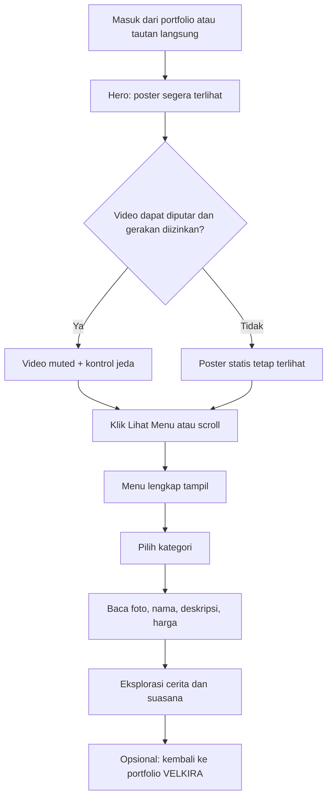
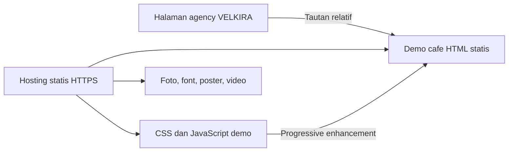
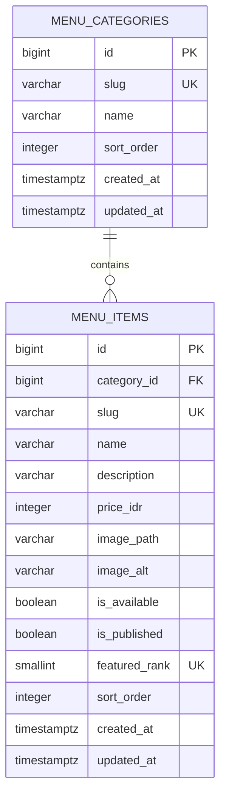

# BLUEPRINT — SunsDays / Portfolio VELKIRA

Dokumen produk, arsitektur, data, desain, dan rencana implementasi.

| Metadata | Nilai |
| --- | --- |
| Versi | 1.0 |
| Tanggal | 25 Oktober 2026, Asia/Jakarta |
| Pemilik produk | Pemilik VELKIRA |
| Jenis proyek | Website cafe fiktif untuk portfolio agency |
| Status | Rancangan lengkap untuk implementasi; aplikasi belum dibuat |
| Bahasa / mata uang | Indonesia / IDR |
| Nama cafe | SunsDays — ditetapkan oleh pemilik |
| Lingkup MVP | Landing page estetik, video pembuka, eksplorasi menu |
| Lokasi demo yang direncanakan | `demos/sunsdays/` di repository VELKIRA |

## Cara menggunakan dokumen ini

Dokumen ini menyatukan Tahap 1–5 dari instruksi yang dilampirkan. Implementasi dimulai setelah dokumen ditinjau, melalui tiket pada Tahap 5. SQL pada Tahap 3 hanya rancangan untuk fase CMS, bukan migrasi yang perlu dijalankan sekarang. Tidak ada kode aplikasi yang dibuat oleh dokumen ini.

Urutan keputusan: instruksi terbaru pemilik → batas MVP → kriteria penerimaan → rancangan teknis. Bila lingkup berubah, perbarui bagian terkait dan catat keputusan sebelum menambah fitur. Jangan menganggap checklist kosong sebagai pekerjaan selesai.

## 0. Keputusan dan asumsi

### 0.1 Sudah ditetapkan dari percakapan

- Website merupakan proyek konsep portfolio VELKIRA, bukan cafe yang sedang beroperasi.
- Target utama: Gen Z yang menyukai estetika dan mayoritas menggunakan ponsel.
- Prioritas: suasana kopi pada landing page dan melihat menu.
- Hero menggunakan video; arah visual tetap biru elektrik dengan aksen merah scarlet.
- Nama cafe adalah **SunsDays**; gunakan kapitalisasi ini pada logo, copy, dan metadata. Slug URL/folder menggunakan `sunsdays`.
- Belum membutuhkan transaksi, reservasi, login, atau pengelolaan menu oleh staf.
- Tahap ini menghasilkan dokumen perencanaan, belum menjalankan implementasi atau deployment.

### 0.2 Asumsi kerja yang dapat diganti

| Hal | Asumsi untuk melanjutkan | Dampak jika berubah |
| --- | --- | --- |
| Karakter | Cafe urban dengan fotografi kopi hangat | Perbarui moodboard dan arahan aset |
| Kategori | Coffee, Non-Coffee, Bites | Sesuaikan konten dan tombol kategori |
| Jumlah produk | 9 produk contoh, masing-masing kategori 3 | Sesuaikan jumlah kartu dan pengujian |
| Harga | Contoh rentang Rp22.000–Rp36.000 | Bukan harga cafe nyata; selalu diberi penanda contoh |
| Aset | Belum diverifikasi tersedia atau berlisensi | Video/foto final perlu disiapkan sebelum rilis visual |
| Hosting | Rekomendasi GitHub Pages dengan artefak publik terpilih | URL final dan batas layanan diperiksa saat deployment |
| Anggaran / tenggat | Belum ditetapkan; gunakan milestone, bukan janji tanggal | Estimasi diperbarui setelah aset dan kapasitas pengerjaan jelas |

Jawaban terdahulu “ada” belum menjelaskan karakter, harga, atau kepemilikan aset. Dokumen ini tidak menganggap detail tersebut sudah dikonfirmasi. Nama SunsDays telah dipilih pemilik; pemeriksaan merek dagang belum dilakukan.

---

# Tahap 1 — Product Requirements Document

## 1.1 Executive Summary

Bangun satu landing page cafe yang membuat pengunjung langsung merasakan identitas brand melalui video kopi, tipografi ekspresif, dan komposisi urban. Setelah kesan pertama, pengunjung dapat menjelajahi menu serta harga tanpa pindah halaman atau menunggu video selesai.

Masalah yang diselesaikan: pengalaman website cafe yang kurang berkarakter atau terlalu dekoratif sehingga menu sulit ditemukan. Keberhasilan ditentukan oleh daya tarik visual sekaligus kemudahan eksplorasi, bukan jumlah animasi.

Untuk VELKIRA, demo ini menjadi karya portfolio yang menunjukkan desain, pengembangan responsif, aksesibilitas, dan kemampuan mengelola media. Proyek harus memiliki identitas sendiri, bukan salinan merek atau aset cafe lain.

## 1.2 Tujuan bisnis, KPI, dan pengukuran

| ID | Tujuan / KPI | Target penerimaan | Metode |
| --- | --- | --- | --- |
| K01 | Menu mudah ditemukan | ≥4 dari 5 peserta membuka bagian menu dalam 10 detik sejak halaman siap | Uji dengan calon pengguna; mulai dari bagian atas |
| K02 | Informasi mudah dipahami | ≥4 dari 5 peserta menemukan nama dan harga produk tertentu tanpa bantuan | Tugas pencarian produk |
| K03 | Kesan visual sesuai target | Rata-rata ≥4/5 untuk penilaian daya tarik dan konsistensi | Dua pertanyaan penilaian setelah mencoba |
| K04 | Fungsi tetap tersedia | Menu, judul, dan CTA tersedia pada seluruh skenario fallback kritis | Matriks QA pada bagian 5.4 |
| K05 | Demo mendukung portfolio | Tautan demo dari agency bekerja dan label konsep terlihat | Uji tautan serta pemeriksaan copy |
| K06 | Pengalaman mobile stabil | Tidak ada overflow horizontal pada viewport uji; target performa pada 1.8 | Pemeriksaan mobile dan Lighthouse |

KPI di atas merupakan target, bukan hasil uji. Lima peserta memberi sinyal awal, bukan bukti statistik mewakili seluruh Gen Z. Sampel diutamakan berusia 18–27 tahun dan menggunakan ponsel.

Analytics pihak ketiga belum dipasang. Jika kelak dibutuhkan, event yang direncanakan: `menu_cta_click`, `menu_category_change`, dan `portfolio_demo_open`, tanpa nama, nomor telepon, atau identifier pribadi. CTR baru ditargetkan setelah baseline tersedia.

## 1.3 Persona dan kebutuhan

### Persona A — Pengunjung pencari suasana

- Usia asumsi 18–27 tahun; membuka lewat media sosial atau tautan teman.
- Ingin merasakan suasana, melihat minuman menarik, dan memahami kisaran harga.
- Hambatan: video berat, teks di atas video tidak terbaca, menu tersembunyi, atau navigasi berlebihan.
- Job story: “Saat menemukan cafe yang tampilannya menarik, saya ingin cepat melihat menu supaya tahu apakah pilihan dan harganya cocok.”

### Persona B — Calon klien agency

- Membuka demo dari portfolio VELKIRA di desktop atau ponsel.
- Ingin menilai kualitas desain, konsistensi komponen, dan pengalaman nyata.
- Hambatan: tautan rusak, interaksi palsu, atau proyek konsep yang diklaim sebagai klien nyata.
- Job story: “Saat menilai agency, saya ingin mencoba hasil kerjanya agar bisa membayangkan kualitas website bisnis saya.”

## 1.4 Core user flow



Alur selesai pada eksplorasi menu. Tidak ada checkout atau kontak cafe palsu. Tautan kembali ke agency harus jelas bertuliskan “Portfolio VELKIRA”, bukan “Pesan kopi”. Deep link `#menu` langsung menuju menu tanpa tertutup header.

## 1.5 Ruang lingkup dan prioritas

| ID | MVP / Must-Have | Kriteria penerimaan |
| --- | --- | --- |
| F01 | Header dan navigasi | Wordmark, anchor Menu/Cerita/Suasana, CTA; berfungsi dengan keyboard |
| F02 | Hero video | Poster, judul, deskripsi, CTA terlihat sebelum video siap; tanpa suara |
| F03 | Kontrol gerakan | Tombol jeda/putar mengikuti keadaan video; reduced motion memakai poster |
| F04 | Menu andalan | Tepat 3 pilihan editorial; tidak memakai klaim popularitas fiktif |
| F05 | Menu lengkap | 9 produk contoh dan kategori Semua/Coffee/Non-Coffee/Bites |
| F06 | Filter kategori | Klik kategori memperbarui kartu serta jumlah hasil tanpa memindahkan fokus |
| F07 | Cerita dan suasana | Copy singkat dan 3 foto; tidak mengarang alamat atau testimoni nyata |
| F08 | Footer | Kredit, label konsep, penanda harga contoh, tautan kembali ke agency |
| F09 | Progressive enhancement | Semua produk dan navigasi tetap tersedia tanpa JavaScript |
| F10 | Responsif, SEO, aksesibilitas | Lulus kriteria 1.8 dan pemeriksaan pada 5.4 |
| F11 | Integrasi portfolio | Tambah kartu demo atau perbarui satu kartu relevan tanpa merusak konsep lainnya |

**Fase 2 / Nice-to-Have:** CMS, status ketersediaan yang dapat diedit staf, pencarian, detail produk jika informasi bertambah, integrasi lokasi/kontak nyata, analytics, serta galeri lanjutan.

**Fase transaksi terpisah:** reservasi, keranjang, pembayaran, voucher, loyalty, akun pelanggan. Fitur ini memerlukan PRD dan model data baru; skema CMS di Tahap 3 belum mencakup transaksi.

**Tidak masuk MVP:** backend, database, admin, login, formulir, PWA/offline cache, pelacakan pengguna, slider otomatis, WebGL, cursor khusus, scroll hijacking, atau musik otomatis.

## 1.6 Sitemap dan rincian komponen

| Lokasi | Komponen dan konten | Perilaku |
| --- | --- | --- |
| `/demos/sunsdays/` | Satu dokumen HTML berbahasa Indonesia | Dapat dibuka langsung tanpa routing SPA |
| `#awal` | Header, hero, label kecil konsep, video/poster, satu H1, CTA Lihat Menu | CTA scroll ke `#menu`; gerakan mengikuti preferensi |
| `#andalan` | Judul singkat dan 3 kartu pilihan | Tautan Lihat Semua Menu menuju `#menu` |
| `#menu` | H2, catatan harga contoh, kategori, jumlah hasil, 9 kartu | Default Semua; filter lokal tanpa request jaringan |
| `#cerita` | H2, narasi 60–90 kata, satu visual | Narasi brand fiktif tanpa klaim operasional |
| `#suasana` | H2 dan galeri 3 foto | Grid statis, tanpa carousel atau lightbox MVP |
| Footer | Label concept project, kredit aset, Portfolio VELKIRA, kembali ke atas | Tidak ada alamat/jam buka palsu |
| Halaman agency yang sudah ada | Kartu portfolio, deskripsi singkat, preview | Membuka demo dalam tab yang sama; tombol kembali tersedia |

Tidak dibuat halaman `/menu` terpisah pada MVP. Folder dan anchor menggunakan path relatif agar dapat berjalan di subpath repository GitHub Pages.

### Spesifikasi konten

- Bahasa utama Indonesia; nama minuman dapat memakai istilah umum bahasa Inggris.
- Copy hero usulan: “Kopi enak. Ritme sendiri.”; CTA “Lihat Menu”.
- Menu contoh: Espresso, Iced Americano, Blue Hour Latte; Matcha Latte, Chocolate, Scarlet Berry; Butter Croissant, Cinnamon Roll, Chocolate Cookie.
- Nama/visual Blue Hour dan Scarlet Berry adalah arah kreatif, bukan pernyataan resep atau bahan tertentu.
- Setiap produk memiliki nama, kategori, deskripsi ≤140 karakter, harga integer IDR, foto dan alt text.
- Teks dekat menu: “Menu dan harga merupakan contoh untuk proyek konsep.”
- Tidak menyatakan bebas alergen, halal, organik, atau klaim gizi tanpa dasar.
- Tidak menaruh teks penting langsung di dalam gambar/video.

## 1.7 Edge cases dan respons produk

| Kasus | Respons yang diwajibkan | Verifikasi |
| --- | --- | --- |
| Autoplay ditolak | Poster tetap ada; kontrol menjadi Putar Video bila video tersedia | Blok autoplay, cek CTA tetap bekerja |
| Video 404, decode error, atau macet | Tampilkan poster, hentikan indikator loading; jangan tampilkan kontrol yang tidak berfungsi | Blok request video |
| Koneksi lambat | HTML, CSS dan poster didahulukan; jangan menunggu video untuk membuka menu | Simulasi Slow 4G |
| Hemat data terdeteksi | Tidak memuat video otomatis; sediakan pilihan putar | Simulasi bila API tersedia; API bukan syarat fungsi |
| Reduced motion aktif/berubah | Jangan autoplay; pause video ketika preferensi berubah; hilangkan reveal/scroll animasi | Emulasi preferensi sebelum dan sesudah load |
| Tab tersembunyi / hero di luar layar | Pause; hanya resume bila sebelumnya autoplay dan tidak dijeda pengguna | Pindah tab dan scroll |
| Foto gagal | Latar netral dan alt text; dimensi tetap; tidak melakukan retry tanpa batas | Blok satu gambar |
| JavaScript gagal | Semua menu tetap tampil; kategori interaktif tidak ditampilkan | Matikan JS |
| Kategori kosong | Jangan tampilkan filter kosong; jika kondisi berubah, reset ke Semua dengan pemberitahuan singkat | Data uji kosong |
| Seluruh menu kosong | Pesan “Menu contoh belum tersedia”; jangan tampilkan harga/kartu palsu | Fixture HTML kosong saat pengujian |
| Produk tidak tersedia pada data contoh | Label “Belum tersedia”; tetap dapat dibaca tanpa tombol pesan | Uji satu produk unavailable |
| Klik filter cepat/berulang | State terakhir menang; tidak menggandakan kartu atau listener | Klik berulang dan keyboard |
| Judul panjang / zoom 200% | Kartu bertambah tinggi; informasi tidak terpotong | Nama 60 karakter dan zoom |
| Deep link / back browser | Anchor tetap valid; filter tidak menimpa hash | Buka URL `#menu` langsung |
| Font gagal | Fallback sistem, layout tetap terbaca | Blok file font |
| Aset belum berlisensi | Tahan publikasi aset; gunakan aset dengan izin tercatat | Pemeriksaan manifest aset |
| URL demo atau aset salah di subpath | Gunakan path relatif dan uji URL produksi lengkap | Smoke test deployment |

Checkout stok habis, double submit formulir, pembayaran gagal, atau email tidak terkirim tidak berlaku pada MVP. Jika fitur tersebut ditambahkan, definisikan alur recovery sebelum implementasi.

## 1.8 Non-functional requirements

### Performa dan media

- Target Core Web Vitals lapangan: LCP ≤2,5 detik, INP ≤200 ms, CLS ≤0,1 pada persentil ke-75 jika data pengguna cukup. Ini target, bukan jaminan skor atau ranking pencarian. Rujukan: [Google Core Web Vitals](https://developers.google.com/search/docs/appearance/core-web-vitals).
- Sebelum ada data lapangan: median 3 pengujian Lighthouse mobile dengan konfigurasi sama; target Performance ≥90, LCP ≤2,5 detik, CLS ≤0,1. Catat URL, tanggal, versi tool, throttling, dan hasil; jangan menyamakan TBT dengan INP lapangan.
- Anggaran awal transfer sebelum video: ≤800 KB terkompresi, termasuk poster dan font yang dimuat awal. HTML+CSS+JS gabungan ≤150 KB terkompresi. Total JS demo ≤30 KB terkompresi.
- Video 6–10 detik, loop yang halus, MP4 H.264 tanpa audio sebagai baseline; target ≤3 MB. WebM opsional bila memberi penghematan terukur. Hindari embed YouTube/Vimeo untuk background.
- Poster responsif dengan rasio sama seperti area video; target file terpilih ≤200 KB. Poster bukan lazy-loaded; gambar menu/galeri di bawah fold lazy-loaded.
- Cadangkan dimensi seluruh media. Gunakan `object-fit: cover` dengan titik fokus yang tidak memotong cangkir/aksi utama pada mobile.
- Hero mengutamakan poster. Source video baru dipasang setelah konten awal siap dan preferensi diperiksa; default tidak mengunduh video pada reduced motion. Jangan preload video bersamaan dengan poster prioritas tinggi.
- Jika video belum menghasilkan frame dalam 8 detik, hentikan upaya autoplay dan kembali ke poster; pengunjung boleh mencoba putar secara manual. Tidak ada layar loading penuh.
- Font lokal WOFF2 maksimal dua keluarga dan weight yang digunakan saja, dengan `font-display: swap` serta lisensi disimpan.

### Aksesibilitas

- Target WCAG 2.2 AA untuk seluruh halaman; audit otomatis dilengkapi keyboard dan pembaca layar.
- Teks normal minimal kontras 4,5:1; teks besar 3:1; batas kontrol/indikator penting 3:1 terhadap sekitarnya.
- Area sentuh utama ditargetkan minimal 44×44 CSS px; jarak antarkontrol cukup.
- Skip link, landmark semantik, satu H1, urutan heading, fokus terlihat, dan label tombol tersedia.
- Video dekoratif tidak memuat informasi eksklusif. Tombol jeda berada di luar elemen media dan bisa digunakan dengan keyboard. Gerakan otomatis lebih dari 5 detik memiliki mekanisme pause/stop sesuai [WCAG Pause, Stop, Hide](https://www.w3.org/WAI/WCAG22/Understanding/pause-stop-hide.html).
- Tidak ada konten yang awalnya tersembunyi hanya untuk animasi reveal; kegagalan animasi tidak boleh membuat halaman kosong.
- Reduced motion menonaktifkan autoplay, parallax, reveal, dan smooth scroll. Video tidak berkedip atau memakai transisi strobe.

### SEO dan berbagi

- Judul/deskripsi unik, `lang="id"`, HTML menu dapat diindeks, gambar bermakna memiliki alt text.
- Metadata Open Graph memakai judul, deskripsi, dan gambar preview 1200×630.
- Canonical dan URL OG absolut ditetapkan setelah URL publik final tersedia, bukan alamat localhost.
- Preview belum final boleh `noindex`; demo portfolio final boleh diindeks bila disetujui sebagai karya konsep. Penanda konsep tetap terlihat.
- Sitemap hanya berisi URL halaman yang benar-benar dipublikasikan, bukan setiap anchor.
- Hindari schema LocalBusiness/Restaurant, rating, jam buka, alamat, atau ulasan fiktif. Structured data tidak wajib untuk MVP.

### Keamanan, privasi, kompatibilitas

- HTTPS di hosting; tidak ada mixed content, secret, atau data pribadi di frontend.
- Tidak memakai `innerHTML` dengan input/data tidak terpercaya. Filter membatasi slug kategori yang dikenal.
- Tidak membuka direktori Git, `.env`, arsip, atau dokumen internal dalam artefak hosting.
- Tidak menambahkan tracker, cookie aplikasi, atau formulir tanpa kebutuhan produk. Hosting dapat memiliki log akses sesuai kebijakannya.
- Hindari script/font remote saat runtime; pembaruan dependensi hanya jika memang dipakai.
- Uji pada versi stabil Chrome, Edge, Firefox dan Safari saat implementasi, ditambah Android Chrome dan iOS Safari. Catat versi nyata yang diuji.
- Lebar pengujian: 360, 390, 768, 1024, dan 1440 px; tidak ada overflow horizontal. Periksa 320 px sebagai stress test.

---

# Tahap 2 — Technical Blueprint

## 2.1 Rekomendasi tech stack

| Lapisan | Pilihan MVP | Alasan |
| --- | --- | --- |
| Frontend | HTML5 semantik, CSS custom properties, JavaScript vanilla | Satu halaman, sedikit state, sesuai teknologi repo agency saat ini |
| Bahasa / typing | JavaScript sederhana; JSDoc bila bentuk data perlu dijelaskan | Tidak membutuhkan toolchain TypeScript untuk interaksi sekecil ini |
| Styling | CSS lokal dengan token dan komponen bernama konsisten | Kontrol visual penuh tanpa menambah framework |
| Backend | Tidak ada | Tidak ada transaksi, form, atau konten privat |
| Database | Tidak ada pada MVP | Konten menu statis; skema CMS hanya disiapkan di Tahap 3 |
| State | DOM dan variabel lokal | Hanya kategori aktif, navigasi, dan playback |
| Media | MP4 + poster WebP/AVIF dengan fallback; font WOFF2 lokal | Kontrol ukuran, fallback, dan privasi |
| Hosting rekomendasi | GitHub Pages via artefak GitHub Actions yang dipilih | Cocok untuk file statis dan repo yang sudah di GitHub |
| QA | Browser DevTools, Lighthouse, axe; Playwright jika dipakai untuk regresi interaksi | Pengujian fokus pada perilaku berisiko |
| Payment / email / auth | Tidak dipasang | Tidak memiliki kebutuhan MVP |

GitHub Pages mendukung hosting HTML/CSS/JS statis; kesesuaian paket repository dan batas layanan dicek saat rilis. Tidak mengasumsikan harga, bandwidth, atau kuota selalu tetap. Lihat [GitHub Pages](https://docs.github.com/en/pages/getting-started-with-github-pages/what-is-github-pages) dan [HTTPS Pages](https://docs.github.com/en/pages/getting-started-with-github-pages/securing-your-github-pages-site-with-https).

Next.js + Tailwind + Supabase, Laravel, atau WordPress belum dibutuhkan. Jika kebutuhan berubah menjadi multi-halaman berbasis CMS, evaluasi ulang berdasarkan kebutuhan editorial, bukan sekadar mengganti stack agar terlihat modern.

## 2.2 Arsitektur dan batas integrasi



- Source agency di root tetap menjadi website utama. Demo memiliki CSS, JS, dan aset sendiri.
- Class demo tidak dibagikan dengan agency; jika perlu gunakan prefix `cafe-` untuk mencegah kebocoran selector saat integrasi kelak.
- HTML menu merupakan sumber kebenaran MVP. JavaScript hanya menyaring kartu melalui atribut kategori dan memperbarui kontrol; tidak membuat salinan menu dalam JSON.
- Tidak ada fetch menu saat runtime. Ini menjaga SEO, fallback tanpa JS, dan menghindari spinner yang tidak diperlukan.
- Penambahan CMS nanti mengganti sumber konten dengan build-time export atau rendering yang disepakati; jangan menulis dua sumber menu manual.
- Pemisahan tanggung jawab cukup pada konten/markup, styling, perilaku, dan aset. Tidak memerlukan lapisan repository/service/controller tanpa backend.

## 2.3 Struktur folder yang direncanakan

```text
Velkira-Website/
├── BLUEPRINT.md                     # Dokumen ini; tidak ikut artefak hosting
├── README.md                        # Panduan agency; tambahkan cara membuka demo saat implementasi
├── index.html                       # Agency; perubahan terbatas pada kartu portfolio
├── styles.css                       # Agency
├── script.js                        # Agency
├── animations.js                    # Agency
├── config.js                        # Kontak agency, bukan konfigurasi cafe
├── assets/                          # Aset agency yang sudah ada
├── dokumen/
│   └── cafe/
│       ├── asset-manifest.md        # Sumber, izin, atribusi, ukuran aset
│       └── qa-report.md             # Hasil uji aktual dan keterbatasan
├── demos/
│   └── sunsdays/
│       ├── index.html               # Seluruh konten dan menu semantik
│       ├── styles.css               # Token, layout, komponen, responsif
│       ├── script.js                # Filter, menu mobile, kontrol video
│       └── assets/
│           ├── brand/               # Wordmark, favicon, OG preview
│           ├── fonts/               # WOFF2 dan lisensi font
│           ├── images/              # Poster, menu, suasana
│           └── video/               # Hero loop MP4; WebM opsional
├── tests/                           # Dibuat bila otomatisasi diperlukan
│   └── cafe.spec.js                 # Filter, fallback, navigasi, reduced motion
└── .github/
    └── workflows/
        └── pages.yml                # Menyiapkan artefak publik terpilih
```

Tree di atas adalah rencana, bukan daftar file yang sudah dibuat. Folder `public-site/` dapat menjadi direktori staging sementara saat deployment dan tidak perlu masuk Git. Artefak hanya memuat file publik agency serta `demos/`; tidak menyalin root repo secara menyeluruh.

## 2.4 Strategi state management

| State | Sumber / nilai awal | Aturan |
| --- | --- | --- |
| Kategori | `all` | Lokal di memori; tidak disimpan ke localStorage atau URL |
| Navigasi mobile | Tertutup setelah enhancement | Tanpa JS, link tetap terlihat; Escape menutup dan mengembalikan fokus |
| Video | Poster / belum diputar | Status mengikuti event media aktual, bukan asumsi setelah klik |
| Jeda pengguna | `false` | Setelah pengguna pause, scroll/tab aktif tidak boleh memutar ulang otomatis |
| Reduced motion | Media query OS | Dipantau perubahannya; mengalahkan autoplay |
| Hemat data | Best effort jika tersedia | Jika tidak didukung, fallback poster-first tetap berlaku |

Filter menggunakan tombol `aria-pressed`, bukan tab ARIA bila tidak menerapkan pola tabs lengkap. Jumlah hasil diumumkan melalui status `aria-live="polite"`; jangan mengumumkan seluruh grid berkali-kali.

## 2.5 Caching dan pengiriman aset

- MVP memakai cache HTTP bawaan hosting; tidak ada service worker atau cache aplikasi.
- Gunakan nama aset berversi, misalnya `hero-v1.mp4`; ubah nama saat konten diganti. Bersihkan aset lama hanya setelah semua referensi diganti.
- HTML perlu memperoleh revisi terbaru melalui kebijakan hosting. Verifikasi response headers aktual; jangan mengklaim kontrol header kustom jika provider tidak mendukungnya.
- Pada hosting yang mendukung konfigurasi header, target aset berversi: cache jangka panjang; HTML: revalidation. GitHub Pages mengikuti fasilitas yang tersedia.
- Cache bukan tempat menyimpan informasi harga yang terpisah dari HTML.

## 2.6 Autentikasi dan keamanan

- Pengunjung MVP anonim; tidak ada halaman login, session, cookie auth, atau endpoint tulis.
- Akses pengembang dikelola melalui izin repository dan akun hosting; bukan autentikasi aplikasi.
- Deployment workflow memakai permission minimum. Jangan menyimpan personal access token di HTML atau konfigurasi publik.
- Local preview terikat `127.0.0.1`; sajikan hanya file website yang diperlukan. Jangan membuka seluruh workspace ke jaringan.
- Jika CMS ditambahkan, endpoint admin memerlukan pemeriksaan role di server. Menyembunyikan tombol bukan kontrol akses.

## 2.7 Environment variables

**MVP: tidak ada environment variable yang wajib dan tidak perlu membuat `.env`.** Domain dan path publik dimasukkan saat persiapan rilis; bukan secret. Jangan menambah key payment, email, atau Supabase tanpa layanan yang dipakai.

| Nama, hanya jika diperlukan kemudian | Sifat | Penggunaan |
| --- | --- | --- |
| `SITE_URL` | Publik, build-time | Origin produksi untuk metadata; tidak boleh localhost pada rilis |
| `BASE_PATH` | Publik, build-time | Subpath repository bila generator/build kelak digunakan |
| `DATABASE_URL` | Secret server | Koneksi PostgreSQL fase CMS; tidak dikirim ke browser |
| `SESSION_SECRET` | Secret server | Hanya jika implementasi auth memilih session bertanda tangan |
| `MEDIA_STORAGE_BUCKET` | Konfigurasi server | Hanya jika media berpindah ke object storage |

Variabel CMS ini daftar kebutuhan potensial, bukan stack yang telah dipasang. Jika memakai auth/storage provider, tetapkan nama variabel sesuai SDK yang dipilih saat fase itu. `.env.example` nanti hanya berisi nama dan nilai contoh non-rahasia; `.env` tetap diabaikan Git.

---

# Tahap 3 — Model Data, ERD, dan API Contract

## 3.1 Keputusan database MVP

MVP tidak memiliki database. Konten menu disimpan di HTML sehingga tersedia sebelum JavaScript berjalan. Mengunci model data tetap penting, tetapi tidak berarti setiap landing page perlu server database.

### Kontrak konten MVP

| Field | Tipe konseptual | Aturan |
| --- | --- | --- |
| `id` | String slug | Unik, stabil, huruf kecil/angka/hyphen |
| `category` | Enum slug | `coffee`, `non-coffee`, atau `bites` |
| `name` | String | 1–60 karakter |
| `description` | String | 1–140 karakter |
| `price_idr` | Integer | >0; format rupiah di tampilan, bukan disimpan sebagai “25k” |
| `image_path` | String path relatif | Mengarah ke aset lokal yang ada |
| `image_alt` | String | 1–160 karakter untuk foto informatif |
| `is_available` | Boolean | Default true; false menampilkan label Belum Tersedia |
| `featured_rank` | Integer/null | 1–3 untuk tiga pilihan; lainnya null; tidak boleh duplikat |
| `sort_order` | Integer | ≥0; urutan kartu stabil |

Dalam HTML, nama/deskripsi/harga merupakan konten semantik; tidak semua field perlu diduplikasi sebagai atribut. Hanya ID kategori dan informasi yang diperlukan interaksi menjadi data attribute. Validasi konten dilakukan saat authoring/QA.

## 3.2 Skema relasional opsional untuk fase CMS

Status: **rancangan tertunda**, hanya dipakai jika pengelolaan konten disetujui. Bukan prasyarat implementasi MVP. Dua tabel cukup untuk menu; foto hero, galeri, dan cerita tetap aset/konten statis sampai kebutuhan editorialnya jelas.



### Data dictionary

| Tabel / kolom | Tipe | Null / default | Key / validasi |
| --- | --- | --- | --- |
| categories.id | bigint identity | Not null, generated | PK |
| categories.slug | varchar(60) | Not null | Unique, format slug |
| categories.name | varchar(60) | Not null | Trim tidak kosong |
| categories.sort_order | integer | Not null, 0 | ≥0 |
| categories.created_at | timestamptz | Not null, now | Waktu pembuatan |
| categories.updated_at | timestamptz | Not null, now | Diubah server pada update |
| items.id | bigint identity | Not null, generated | PK |
| items.category_id | bigint | Not null | FK categories.id, delete restrict |
| items.slug | varchar(80) | Not null | Unique, format slug |
| items.name | varchar(60) | Not null | Trim tidak kosong |
| items.description | varchar(140) | Not null | Trim tidak kosong |
| items.price_idr | integer | Not null | >0, IDR rupiah penuh |
| items.image_path | varchar(255) | Not null | Path relatif aset; divalidasi server |
| items.image_alt | varchar(160) | Not null | Trim tidak kosong |
| items.is_available | boolean | Not null, true | Ketersediaan, bukan stok numerik |
| items.is_published | boolean | Not null, false | Draft tidak boleh muncul di API publik |
| items.featured_rank | smallint | Nullable | Unique 1–3 jika terisi |
| items.sort_order | integer | Not null, 0 | ≥0 |
| items.created_at | timestamptz | Not null, now | Waktu pembuatan |
| items.updated_at | timestamptz | Not null, now | Diubah server pada update |

Nama tabel sebenarnya menggunakan prefix `menu_`. ID bigint direpresentasikan sebagai string dalam JSON untuk menghindari batas integer JavaScript. `featured_rank` unik membatasi maksimal tiga pilihan; syarat tepat tiga produk published diperiksa saat publikasi. Menghapus kategori berisi produk ditolak, bukan menghapus menu secara berantai.

### SQL PostgreSQL — spesifikasi skema, belum dijalankan

```sql
CREATE TABLE menu_categories (
    id bigint GENERATED ALWAYS AS IDENTITY PRIMARY KEY,
    slug varchar(60) NOT NULL UNIQUE
        CHECK (slug ~ '^[a-z0-9]+(-[a-z0-9]+)*$'),
    name varchar(60) NOT NULL CHECK (length(btrim(name)) > 0),
    sort_order integer NOT NULL DEFAULT 0 CHECK (sort_order >= 0),
    created_at timestamptz NOT NULL DEFAULT now(),
    updated_at timestamptz NOT NULL DEFAULT now()
);

CREATE TABLE menu_items (
    id bigint GENERATED ALWAYS AS IDENTITY PRIMARY KEY,
    category_id bigint NOT NULL
        REFERENCES menu_categories(id) ON DELETE RESTRICT,
    slug varchar(80) NOT NULL UNIQUE
        CHECK (slug ~ '^[a-z0-9]+(-[a-z0-9]+)*$'),
    name varchar(60) NOT NULL CHECK (length(btrim(name)) > 0),
    description varchar(140) NOT NULL
        CHECK (length(btrim(description)) > 0),
    price_idr integer NOT NULL CHECK (price_idr > 0),
    image_path varchar(255) NOT NULL CHECK (length(btrim(image_path)) > 0),
    image_alt varchar(160) NOT NULL CHECK (length(btrim(image_alt)) > 0),
    is_available boolean NOT NULL DEFAULT true,
    is_published boolean NOT NULL DEFAULT false,
    featured_rank smallint UNIQUE CHECK (featured_rank BETWEEN 1 AND 3),
    sort_order integer NOT NULL DEFAULT 0 CHECK (sort_order >= 0),
    created_at timestamptz NOT NULL DEFAULT now(),
    updated_at timestamptz NOT NULL DEFAULT now()
);

CREATE INDEX menu_items_category_idx ON menu_items (category_id);

CREATE INDEX menu_items_public_order_idx
    ON menu_items (category_id, sort_order, id)
    WHERE is_published = true;
```

Primary key dan UNIQUE sudah menyediakan indeks terkait; jangan membuat indeks duplikat. Indeks FK membantu lookup per kategori dan pemeriksaan relasi, sedangkan indeks parsial melayani pembacaan katalog terpublikasi. Jangan menambah indeks pencarian teks untuk sembilan produk tanpa kebutuhan terukur.

SQL tidak mencakup role/grant/auth dan belum menjadi migrasi produksi yang diaudit. Jika diaktifkan, server wajib parameterized query, transaksi untuk reorder beberapa produk, pembaruan `updated_at`, validasi path media, serta akun DB berizin minimum. Jangan mengekspos tabel ini langsung melalui API publik tanpa access policy. Rujukan constraint: [PostgreSQL documentation](https://www.postgresql.org/docs/current/ddl-constraints.html).

## 3.3 API contract MVP

**Tidak ada endpoint API aplikasi pada MVP.** GET HTML/media adalah request file statis, bukan API bisnis. Filter tidak mengirim request. Tidak ada POST, PUT, DELETE, login, atau endpoint dummy yang perlu dibuat.

## 3.4 API contract fase CMS — rancangan tertunda

Aktif hanya setelah backend dan autentikasi dipilih. Base path `/api/v1`. Request/response JSON UTF-8; ID string; waktu ISO 8601 UTC. Tidak memuat data pribadi. Admin-only berarti pemeriksaan role pada server untuk setiap operasi.

| Method / route | Akses | Request | Sukses | Error khusus |
| --- | --- | --- | --- | --- |
| GET `/menu-categories` | Publik | Tanpa body | 200 daftar kategori yang memiliki item published | 500/503 |
| GET `/menu-items` | Publik | Query opsional `category=<slug>` | 200 daftar item published sesuai urutan | 400 query invalid; 404 kategori tidak dikenal |
| GET `/menu-items/:slug` | Publik | Tanpa body | 200 item published | 404 tidak ada atau draft |
| GET `/admin/menu-categories` | Admin | Tanpa body | 200 seluruh kategori | 401/403 |
| GET `/admin/menu-items` | Admin | Tanpa body | 200 seluruh item termasuk draft | 401/403 |
| POST `/admin/menu-categories` | Admin | CategoryWrite | 201 kategori baru + Location | 409 slug duplikat; 422 validasi |
| PUT `/admin/menu-categories/:id` | Admin | CategoryWrite lengkap | 200 kategori diperbarui | 404; 409; 422 |
| DELETE `/admin/menu-categories/:id` | Admin | Tanpa body | 204 tanpa body | 404; 409 masih berisi item |
| POST `/admin/menu-items` | Admin | ItemWrite | 201 item baru + Location | 409 slug/rank duplikat; 422 |
| PUT `/admin/menu-items/:id` | Admin | ItemWrite lengkap | 200 item diperbarui | 404; 409; 422 |
| DELETE `/admin/menu-items/:id` | Admin | Tanpa body | 204 tanpa body | 404 |

Menu kecil dikembalikan sekaligus tanpa pagination. Jika katalog tumbuh signifikan, revisi kontrak sebelum menambahkan pagination. GET publik hanya memuat `is_published=true`; kategori valid tanpa hasil mengembalikan 200 dengan array kosong. Draft detail mengembalikan 404, tidak membocorkan keberadaan draft.

### Payload CategoryWrite

```json
{
  "slug": "coffee",
  "name": "Coffee",
  "sort_order": 0
}
```

### Payload ItemWrite

```json
{
  "category_id": "1",
  "slug": "blue-hour-latte",
  "name": "Blue Hour Latte",
  "description": "Espresso dan susu dengan karakter lembut.",
  "price_idr": 32000,
  "image_path": "assets/images/blue-hour-latte-v1.webp",
  "image_alt": "Segelas iced latte dengan lapisan espresso dan susu",
  "is_available": true,
  "is_published": true,
  "featured_rank": 1,
  "sort_order": 2
}
```

POST dan PUT memakai field lengkap di atas; `featured_rank` boleh null. Server menolak field tidak dikenal, nilai bertipe salah, URL media eksternal, absolute path, `..`, path yang tidak ada dalam daftar media, dan referensi kategori tidak valid. ID/timestamp dikelola server. Pada update, ID di URL adalah otoritas; tidak ada `id` di body. PUT memakai penggantian field penuh, bukan partial update.

### Bentuk response

- Kategori tunggal: `{ "data": { "id": "1", "slug": "coffee", "name": "Coffee", "sort_order": 0, "created_at": "2026-10-25T00:00:00Z", "updated_at": "2026-10-25T00:00:00Z" } }`.
- Daftar kategori: `data` berupa array objek kategori dan `meta.count` integer.
- Item tunggal: `data` berisi seluruh field ItemWrite, ditambah `id`, `created_at`, dan `updated_at`.
- Daftar item: `data` berupa array objek item yang sama dan `meta.count` integer. Tidak ada field rahasia pada model ini.
- DELETE 204 tidak mengirim JSON atau body.

Contoh daftar item publik:

```json
{
  "data": [
    {
      "id": "7",
      "category_id": "1",
      "slug": "blue-hour-latte",
      "name": "Blue Hour Latte",
      "description": "Espresso dan susu dengan karakter lembut.",
      "price_idr": 32000,
      "image_path": "assets/images/blue-hour-latte-v1.webp",
      "image_alt": "Segelas iced latte dengan lapisan espresso dan susu",
      "is_available": true,
      "is_published": true,
      "featured_rank": 1,
      "sort_order": 2,
      "created_at": "2026-10-25T00:00:00Z",
      "updated_at": "2026-10-25T00:00:00Z"
    }
  ],
  "meta": { "count": 1 }
}
```

Contoh error validasi:

```json
{
  "error": {
    "code": "VALIDATION_ERROR",
    "message": "Periksa kembali data menu.",
    "fields": { "price_idr": "Harus berupa integer lebih dari 0." },
    "request_id": "req-example-001"
  }
}
```

| Status | Code | Aturan |
| --- | --- | --- |
| 400 | `BAD_REQUEST` | JSON rusak, format ID atau query salah |
| 401 | `UNAUTHENTICATED` | Kredensial tidak ada atau tidak valid |
| 403 | `FORBIDDEN` | Login valid tetapi bukan admin, atau pemeriksaan CSRF gagal |
| 404 | `NOT_FOUND` | Resource tidak ada; draft disembunyikan dari publik |
| 409 | `CONFLICT` | Slug/rank duplikat atau kategori masih dipakai |
| 422 | `VALIDATION_ERROR` | Body valid JSON tetapi field tidak memenuhi kontrak |
| 429 | `RATE_LIMITED` | Batas request terlampaui; sertakan Retry-After |
| 500 | `INTERNAL_ERROR` | Kesalahan internal; tidak membocorkan stack trace/query |
| 503 | `SERVICE_UNAVAILABLE` | Database/dependensi sementara tidak tersedia |

Semua endpoint dapat mengembalikan 500/503; admin juga 401/403; rate limit dapat menghasilkan 429. Response error konsisten dengan contoh; `fields` dihilangkan jika tidak relevan. GET publik dapat di-cache singkat, admin response tidak di-cache. Kebijakan invalidasi katalog ditentukan saat CMS dibangun.

Auth fase CMS: gunakan penyedia terkelola yang dievaluasi saat itu, atau session cookie HttpOnly/Secure/SameSite dengan perlindungan CSRF untuk mutasi. Jangan merancang login sendiri sebelum stack dipilih. POST admin tidak di-retry otomatis; cegah double-submit di UI, kembalikan 409 pada konflik, dan refetch setelah timeout yang hasilnya tidak pasti. Checkout membutuhkan idempotency dan rancangan transaksi tersendiri.

---

# Tahap 4 — Design System dan UI Blueprint

## 4.1 Konsep visual

**Urban coffee editorial:** bidang biru tegas, tipografi besar, fotografi kopi hangat, dan aksen scarlet yang hemat. Bukan tema cafe cokelat generik; warna kopi tetap hadir melalui foto. Hierarki, ruang kosong, dan komposisi menjadi penentu estetika, bukan tumpukan efek.

Inspirasi boleh dipakai untuk mempelajari pola, tanpa menyalin identitas, copy, layout secara persis, atau aset merek lain. Tidak memakai logo Scarlet Urban atau mengklaim keterkaitan dengan brand tersebut.

## 4.2 Palet dan aturan penggunaan

| Token | HEX | Penggunaan |
| --- | --- | --- |
| Primary | `#2457FF` | Bidang brand dan CTA utama |
| Primary hover | `#1846D9` | Hover tombol biru |
| Primary pressed | `#1439B5` | Tombol biru ditekan |
| Secondary / scarlet | `#FF3B45` | Badge dekoratif, garis aksen, bidang kecil |
| Background | `#F5F2EB` | Latar utama |
| Surface | `#FFFFFF` | Kartu dan kontrol |
| Text | `#151515` | Teks utama pada latar terang |
| Text muted | `#545454` | Deskripsi dan metadata |
| Border subtle | `#D8D4CC` | Pemisah dekoratif; bukan satu-satunya batas kontrol |
| Border control | `#76716A` | Batas kontrol di latar terang |
| Focus on light | `#1439B5` | Outline fokus di area terang |
| Focus on dark | `#F5F2EB` | Outline fokus di area gelap/biru |
| Error text / background | `#B42318` / `#FEE4E2` | Error bila ada kebutuhan nyata |
| Success text / background | `#166534` / `#DCFCE7` | Status berhasil bila dibutuhkan |
| Disabled background / text | `#E4E1DB` / `#545454` | Kontrol tidak tersedia |

Aturan pasangan: putih pada biru; teks hitam pada scarlet; teks hitam pada putih tulang. Jangan memakai teks putih kecil di atas scarlet atau teks biru kecil di atas scarlet. Foto hero membutuhkan lapisan gelap yang konsisten, lalu diuji pada frame paling terang. Status selalu memiliki label/ikon, tidak hanya dibedakan warna. Nilai kontras aktual wajib diukur saat implementasi, termasuk hover dan focus.

Distribusi visual awal: sekitar 60% latar netral, 30% biru/foto, 10% aksen; ini panduan komposisi, bukan aturan perhitungan piksel.

## 4.3 Typography

- Heading: [Space Grotesk](https://fonts.google.com/specimen/Space+Grotesk), weight 600/700.
- Body dan UI: [Manrope](https://fonts.google.com/specimen/Manrope), weight 400/600.
- Fallback: `Arial, sans-serif`. Unduh dari sumber resmi, simpan file lisensi, dan sajikan lokal.

| Token | Mobile | Desktop | Line height / ketentuan |
| --- | --- | --- | --- |
| Display H1 | 48 px | 96 px | 0,98–1,05; maksimal sekitar 12 karakter per baris; boleh turun 40 px pada layar 320 px |
| H2 | 32 px | 56 px | 1,1; letter-spacing sekitar -0,03em |
| H3 / nama produk | 22 px | 26 px | 1,2 |
| Lead | 18 px | 20 px | 1,5 |
| Body | 16 px | 16 px | 1,6 |
| Label / button | 14–16 px | 14–16 px | 1,3; weight 600 |
| Caption | 12 px | 13 px | 1,5; bukan untuk harga utama atau CTA |

Gunakan ukuran fluid antara mobile dan desktop. Harga memakai angka tabular bila tersedia. Batas lebar paragraf sekitar 60 karakter. Jangan membuat seluruh teks uppercase; gunakan untuk eyebrow singkat saja.

## 4.4 Layout, spacing, radius, shadow, motion

| Aspek | Spesifikasi |
| --- | --- |
| Spacing scale | 4, 8, 12, 16, 24, 32, 48, 64, 96, 128 px |
| Container | Maksimal 1280 px; gutter 20 px mobile, 32 px tablet, 48 px desktop |
| Section gap | 64 px mobile; 96–128 px desktop |
| Grid | 1 kolom mobile; 2 kolom mulai 640 px; 3 kolom mulai 1024 px; gap 24–32 px |
| Header | Sekitar 72 px; sticky jika tidak mengurangi ruang baca; anchor memiliki scroll offset |
| Hero | Sekitar 80–90svh, mengikuti tinggi konten; jangan kunci tinggi yang memotong teks |
| Card image | Rasio 4:5; hero poster/video memiliki rasio wadah konsisten |
| Radius | Tombol 999 px; kartu 20 px; media hero 0 atau 24 px sesuai komposisi final |
| Border | 1 px; warna mengikuti fungsi dekoratif/kontrol |
| Card shadow | `0 8px 24px rgba(21,21,21,0.08)`; jangan dipakai pada semua elemen |
| Hover | 160–200 ms; perubahan warna atau translate maksimal 2–4 px |
| Reveal opsional | 300–400 ms, jarak maksimal 12 px; konten tetap visible tanpa JS |
| Reduced motion | Tidak ada transform/reveal/smooth scroll atau autoplay |

Tidak memakai preloader layar penuh, animasi intro wajib ditonton, marquee tanpa pause, atau efek yang mengambil alih scroll.

## 4.5 Reusable components dan state

| Komponen | Variasi | State / perilaku |
| --- | --- | --- |
| Navbar | Desktop inline / mobile disclosure | Link current opsional; toggle expanded/collapsed; Escape menutup; no-JS link tetap tersedia |
| Button / CTA link | Primary biru, secondary outline, text link | Default, hover, focus-visible, pressed; disabled hanya untuk action nyata yang unavailable |
| VideoHero | Poster / playing / paused / unavailable | Kontrol label mengikuti keadaan; play promise ditangani; kegagalan tidak menutupi konten |
| SectionHeading | Eyebrow opsional, H2, intro | Teks statis; tidak perlu loading state |
| ProductCard | Standard / editorial / unavailable | Foto, nama, deskripsi, harga; bukan seluruh kartu klik jika tidak ada halaman detail |
| CategoryFilter | Semua + kategori tersedia | `aria-pressed`; keyboard Enter/Space; fokus tetap pada tombol |
| ResultStatus | Jumlah hasil / kosong | Pesan ringkas dengan `aria-live="polite"` setelah interaksi |
| AvailabilityBadge | Tersedia / Belum tersedia | Teks jelas; tidak bergantung pada warna |
| Gallery | Grid 3 gambar | Dimensi tetap, lazy loading; tidak perlu modal |
| ConceptNotice | Compact di hero / lengkap dekat menu/footer | Menjelaskan proyek konsep dan harga contoh |
| Footer | Kredit + tautan agency | Focus/hover link jelas |

**Skeleton:** tidak diperlukan untuk menu statis yang sudah ada di HTML. Gunakan ruang gambar berlatar netral sebagai placeholder media, bukan skeleton berkedip. Skeleton baru relevan jika fase CMS mengambil data secara asinkron.

**Modal, input form, toast, cart:** tidak dibuat karena belum ada alur yang memerlukannya. State loading/disabled tidak ditambahkan sekadar untuk memenuhi daftar komponen.

## 4.6 Wireframe dan arahan aset

```text
DESKTOP
[SunsDays]                 Menu  Cerita  Suasana    [Lihat Menu]
[Video hero + overlay                                            ]
[KOPI ENAK.                 copy singkat             [jeda/putar]  ]
[RITME SENDIRI.             [Lihat Menu]                          ]
[Menu Andalan              kartu 1       kartu 2       kartu 3    ]
[Menu lengkap / contoh harga                                    ]
[Semua] [Coffee] [Non-Coffee] [Bites]              [jumlah hasil]
[kartu]                    [kartu]                    [kartu]
[Cerita singkat                              foto editorial      ]
[Suasana: foto lebar           foto vertikal      foto detail     ]
[Concept project by VELKIRA                  Portfolio VELKIRA   ]

MOBILE
[SunsDays]                                      [Menu]
[Video/poster dengan titik fokus aman                 ]
[Kopi enak. Ritme sendiri.                            ]
[Copy] [Lihat Menu]                       [jeda/putar]
[Andalan: kartu ditumpuk, tanpa carousel otomatis      ]
[Menu + catatan harga contoh                          ]
[Filter dibungkus ke baris berikutnya jika perlu       ]
[Kartu satu kolom + harga jelas                       ]
[Cerita] [Galeri] [Footer konsep + tautan agency        ]
```

Daftar aset minimum: 1 wordmark asli, 1 favicon, 1 preview OG, 1 video hero + poster responsif, 9 foto produk, dan 3 foto suasana. Foto dapat dipakai ulang untuk tiga pilihan andalan; jangan membuat duplikat file. Satu foto cerita dapat memakai salah satu foto suasana bila komposisinya sesuai.

Video: close-up ekstraksi espresso, susu dituang, kondensasi gelas, atau tangan barista. Pencahayaan hangat dengan properti biru/scarlet; tanpa teks tertanam. Hindari merek pihak lain dan wajah yang tidak memiliki izin relevan. Setiap aset dicatat: file, sumber, pembuat, lisensi/izin, atribusi, tanggal akses, ukuran, dan transformasi yang dilakukan. Belum ada aset yang dinyatakan sudah tersedia.

---

# Tahap 5 — Project Rules dan Implementation Plan

## 5.1 Project Rules untuk sesi coding berikutnya

1. Baca BLUEPRINT.md sebelum mengubah demo; kerjakan satu tiket yang diminta dan dependensinya.
2. Jaga website agency tetap berfungsi. Demo berada di folder terpisah dengan aset dan style sendiri.
3. Pakai HTML/CSS/JavaScript vanilla sesuai keputusan MVP. Penambahan framework, backend, atau database memerlukan alasan produk dan revisi blueprint.
4. Bangun mobile-first; konten serta menu harus tersedia sebelum JavaScript. Jangan mengandalkan fetch untuk menu statis.
5. Gunakan token desain; jangan menambah warna, radius, font, atau animasi acak di tiap komponen.
6. Gunakan HTML semantik, keyboard, focus-visible, kontras, dan reduced motion sejak awal.
7. Video tidak boleh menghalangi menu, bersuara otomatis, atau diputar ulang setelah pengguna menjedanya tanpa tindakan pengguna.
8. Tangani kegagalan pada batas yang dapat gagal: playback, pemuatan media, data eksternal bila ada. Tidak perlu try/catch pada setiap fungsi murni.
9. Jangan meninggalkan tombol palsu, TODO pengganti implementasi, placeholder rusak, atau kode yang disingkat. Konten fiktif boleh karena proyek konsep, tetapi harus diberi label.
10. Gunakan aset asli/berizin, path relatif, dan manifest sumber. Jangan menyalin identitas cafe lain.
11. Tidak ada secret, tracker, PII, atau endpoint tulis pada MVP. Jangan memakai kontak agency seolah kontak cafe.
12. Uji perilaku berisiko, bukan menulis tes yang hanya menyalin implementasi. Jangan mengklaim uji perangkat atau metrik yang belum dilakukan.
13. Jangan commit/push/deploy untuk tahap dokumen ini. Saat implementasi/rilis diminta, ikuti cakupan instruksi pemilik yang berlaku saat itu.
14. Perbarui catatan QA dan keputusan saat ada perubahan lingkup. Tidak menandai checklist selesai tanpa bukti.

Rules ini berada di blueprint, belum dipasang sebagai aturan global repo. Tidak membuat AGENTS.md yang berpotensi menerapkan aturan cafe ke seluruh proyek agency.

## 5.2 Checklist implementasi berurutan

Setiap tiket selesai setelah output dan kriteria penerimaannya terpenuhi. Semua tiket di bawah masih belum dikerjakan.

### Fase A — Fondasi produk dan konten

- [ ] **T01 — Lengkapi identitas dan konten SunsDays.** Gunakan nama cafe yang telah dipilih; finalisasi tagline, 9 produk, harga contoh, dan tone copy. Output: daftar konten pada blueprint atau catatan konten. Selesai bila kapitalisasi SunsDays konsisten, tidak ada placeholder ambigu, dan label konsep tersedia. Dependensi: tidak ada.
- [ ] **T02 — Kumpulkan dan optimalkan aset.** Siapkan video, poster, foto, font dan lisensi; catat manifest. Selesai bila aset tersedia secara lokal, izinnya jelas, ukurannya memenuhi budget, serta crop mobile diperiksa. Dependensi: T01.
- [ ] **T03 — Setup folder demo dan preview.** Buat struktur minimum tanpa backend/dependensi runtime; dokumentasikan preview localhost dengan direktori publik terbatas. Selesai bila demo bisa dibuka melalui HTTP dan agency tidak berubah perilakunya. Dependensi: T01.

### Fase B — Design foundation dan halaman statis

- [ ] **T04 — Implementasikan token dan layout dasar.** Warna, font, spacing, container, grid, focus, breakpoints, reduced motion. Selesai bila specimen heading/button/card terbaca pada 360–1440 px dan kontras terukur. Dependensi: T02, T03.
- [ ] **T05 — Bangun seluruh HTML semantik.** Header, hero poster, andalan, menu, cerita, galeri, footer. Selesai bila semua isi dan 9 menu tersedia tanpa JS, satu H1, serta semua anchor valid. Dependensi: T01, T04.
- [ ] **T06 — Rapikan komposisi visual responsif.** Finalisasi crop foto, hierarki tipografi, jarak, wrapping nama/harga, dan zoom. Selesai bila tidak ada overflow, foto terdistorsi, atau teks terpotong pada matriks viewport. Dependensi: T05.

### Fase C — Interaksi dan media

- [ ] **T07 — Navigasi mobile dan kategori.** Tambahkan enhancement dengan kontrol accessible dan jumlah hasil. Selesai bila semua kategori bekerja, klik cepat aman, fokus stabil, dan no-JS tetap menunjukkan menu lengkap. Dependensi: T05.
- [ ] **T08 — Video hero yang andal.** Tambahkan muted/playsinline, poster-first, pause/play, timeout fallback, reduced motion dan pause saat offscreen/tab hidden. Selesai bila semua skenario media pada matriks QA lulus; jeda pengguna dihormati. Dependensi: T02, T05.
- [ ] **T09 — Motion polish.** Tambahkan hover/reveal ringan hanya jika meningkatkan pengalaman. Selesai bila konten tidak bergantung pada animasi dan reduced motion benar-benar menonaktifkannya. Dependensi: T06–T08.

### Fase D — Integrasi portfolio dan metadata

- [ ] **T10 — Hubungkan demo dengan agency.** Tambah kartu konsep cafe, preview, deskripsi, serta link demo dan kembali ke agency. Selesai bila kedua arah bekerja pada root lokal dan subpath hosting; semua konsep agency lain tetap dapat diakses. Dependensi: T06–T08.
- [ ] **T11 — SEO dan konfigurasi rilis.** Isi title, description, OG, favicon; tetapkan canonical, sitemap, dan kebijakan index pada URL final. Selesai bila tidak ada URL localhost atau bisnis/ulasan fiktif pada metadata. Dependensi: T10 dan URL publik yang dipilih.

### Fase E — QA, usability, dan perbaikan

- [ ] **T12 — QA fungsi, accessibility, dan regresi.** Jalankan matriks 5.4, cek console serta network. Otomatiskan filter/fallback/reduced motion bila bermanfaat. Selesai bila semua critical/high issues selesai atau batas tersisa disetujui secara jelas. Dependensi: T07–T11.
- [ ] **T13 — Audit performa dan media.** Catat tiga run Lighthouse mobile, ukuran file, request awal, dan screenshot mobile/desktop. Selesai bila budget terpenuhi atau kompromi dicatat dengan penyebab dan dampaknya. Dependensi: T12.
- [ ] **T14 — Uji lima pengguna target.** Lakukan tugas K01/K02 dan penilaian K03; catat hasil anonim dan perbaiki hambatan. Selesai bila target tercapai atau temuan terbuka dilaporkan. Bila peserta belum tersedia, tandai belum diuji, bukan lulus. Dependensi: T12.

### Fase F — Deployment dan handover

- [ ] **T15 — Siapkan artefak hosting.** Pilih file publik agency dan demo secara eksplisit; jangan unggah dokumen, arsip, Git, atau env. Atur workflow minimum dan HTTPS. Selesai bila isi artefak diaudit serta penayangan di subpath diuji. Dependensi: T11–T13.
- [ ] **T16 — Publikasikan dan smoke test.** Setelah instruksi rilis berlaku, deploy lalu cek URL agency, demo, CSS, font, video, poster, kategori, canonical, dan fallback. Selesai bila respons publik benar dan tidak ada mixed content. Dependensi: T15; hasil T14 dilaporkan bila belum tersedia.
- [ ] **T17 — Handover.** Perbarui README, manifest aset, QA report, daftar keterbatasan, commit rilis dan cara rollback. Selesai bila pengembang berikutnya dapat mengganti menu/media tanpa menebak sumber kebenaran. Dependensi: T16.

**Urutan jalur utama:** T01 → T02/T03 → T04 → T05 → T06/T07/T08 → T09/T10 → T11 → T12 → T13/T14 → T15 → T16 → T17. Tanda slash berarti beberapa pekerjaan dapat dijadwalkan terpisah setelah dependensinya terpenuhi, bukan instruksi menjalankan agen paralel.

CMS/database/API pada Tahap 3 tidak dimasukkan ke checklist MVP. Jika diminta, buat milestone baru untuk auth, migration, access policy, backup, kontrak API, serta QA keamanan.

## 5.3 Definition of Done

- Semua fitur F01–F11 memenuhi kriteria penerimaan; tidak ada kontrol palsu atau link rusak.
- Hero tetap menarik sebagai gambar statis; kegagalan video tidak memblokir pengalaman.
- Semua konten menu dapat dibaca tanpa JavaScript dan tanpa menunggu jaringan tambahan.
- Mobile/desktop, keyboard, reduced motion, dan fallback diuji; hasil aktual tersimpan.
- Label konsep dan harga contoh terlihat; tidak ada kontak, review, alamat, atau klaim bisnis palsu.
- Aset berizin, budget media terukur, dan metadata memakai URL final.
- Agency tidak mengalami regresi. Source dan artefak publik dibedakan.
- Tiga run performa dan hasil usability dilaporkan. Jika belum ada peserta, rilis teknis dapat disebut preview, tetapi KPI usability tetap belum tervalidasi.
- Tidak ada temuan critical/high terbuka tanpa keputusan eksplisit pemilik; laporan tidak menyatakan “aman 100%”.

## 5.4 Matriks QA minimum

| ID | Skenario | Hasil yang harus terlihat |
| --- | --- | --- |
| Q01 | Load pertama desktop/mobile | Poster, H1, CTA tampil cepat dan terbaca |
| Q02 | JS dinonaktifkan | Menu lengkap, anchor, dan link agency tetap berfungsi |
| Q03 | Video diblokir/404/autoplay ditolak | Poster tetap tampil; tidak ada spinner permanen |
| Q04 | Reduced motion sejak awal dan berubah saat berjalan | Video/animasi otomatis berhenti; isi tetap terlihat |
| Q05 | Pause manual lalu scroll/tab kembali | Video tetap pause sampai pengguna memutar lagi |
| Q06 | Filter setiap kategori + klik cepat | Jumlah benar, hanya kartu sesuai kategori tampil, fokus stabil |
| Q07 | Keyboard, Escape, skip link | Semua kontrol terjangkau, fokus terlihat, menu mobile dapat ditutup |
| Q08 | 320–1440 px, zoom 200%, teks panjang | Tidak ada konten terpotong atau overflow halaman |
| Q09 | Foto/font gagal dan jaringan lambat | Fallback rapi, dimensi tidak meloncat, menu tetap terbaca |
| Q10 | URL langsung `#menu` dan subpath GitHub Pages | Anchor/path aset benar, header tidak menutupi judul |
| Q11 | Pemeriksaan pembaca layar | Heading, kategori, harga, dan label kontrol masuk akal |
| Q12 | SEO dan metadata | Satu H1, title/description, OG, canonical final, tidak ada schema bisnis palsu |
| Q13 | Keamanan artefak publik | Tidak ada `.git`, env, dokumen internal, atau secret; HTTPS aktif |
| Q14 | Regresi agency | Navigasi, modal konsep lama, FAQ dan tautan kontak asli masih bekerja |
| Q15 | Menu fixture kosong/unavailable | Pesan kosong/label tersedia tanpa harga atau data buatan baru |
| Q16 | Browser nyata | Chrome/Edge/Firefox/Safari dan mobile diuji; versi dan batas pengujian dicatat |

Prioritaskan otomatisasi Q02–Q06 dan link/path jika tooling tersedia; Q07/Q11/Q16 memerlukan pemeriksaan manual juga. Status awal seluruh pengujian: **belum dijalankan**.

## 5.5 Checklist audit keamanan sebelum rilis

- [ ] Input/data tidak terpercaya tidak dimasukkan sebagai HTML mentah; atribut URL divalidasi.
- [ ] Tidak ada secret, token deploy, `.env`, atau data pribadi di source/artefak publik.
- [ ] Aset dan font tidak memanggil tracker atau host yang tidak diperlukan.
- [ ] Tidak ada request write, form, login, atau checkout tak sengaja pada MVP.
- [ ] Jika fase CMS sudah diaktifkan: audit parameterized query, role server, CSRF/session, rate limit, serta error response tanpa detail internal.
- [ ] Perilaku klik ganda dan timeout diperiksa pada operasi yang benar-benar ada; tidak mengarang pengujian checkout untuk landing page.
- [ ] Periksa heading/meta/alt/kontras, izin aset, dan semua label proyek konsep.

## 5.6 Deployment, observability, dan rollback

- Rilis dari commit yang sudah diperiksa dan catat SHA, URL, tanggal, serta hasil smoke test.
- Workflow menyalin allowlist file publik; deployment default seluruh repo tidak digunakan karena mengandung dokumentasi dan arsip.
- Enforce HTTPS jika tersedia. Periksa status response dan MIME video/font pada hosting nyata; dukungan seeking/range diperiksa bila diperlukan oleh playback.
- Observability MVP: console/network bersih saat QA dan log workflow deployment. Belum ada error tracking pihak ketiga atau analytics pengguna.
- Jika deploy rusak, redeploy artefak/commit rilis terakhir yang lulus. Hindari force push atau penghapusan riwayat sebagai mekanisme rollback.
- Setelah mengganti aset, cek cache lama tidak menghasilkan link 404. Pertahankan nama aset lama sampai seluruh referensi baru terpublikasi.
- README handover memuat cara preview, lokasi edit menu, lokasi aset, proses deploy, serta batas demo yang nyata.

## 5.7 Risiko dan mitigasi

| Risiko | Dampak | Mitigasi |
| --- | --- | --- |
| Video bagus tetapi terlalu berat | Loading lambat dan penggunaan data tinggi | Poster-first, budget file, compress, fallback |
| Biru/scarlet mendominasi foto | Produk kurang menggugah selera atau teks sulit dibaca | Netral cukup, foto hangat, uji kontras |
| Aset belum tersedia/izin tidak jelas | Rilis visual tertahan | Manifest aset dan penyelesaian T02 sebelum polish |
| SunsDays dianggap cafe operasional | Pengunjung salah memahami demo | Penanda konsep dekat hero, menu, footer |
| File agency berubah terlalu luas | Regresi website utama | Demo terisolasi, integrasi kecil, Q14 |
| Framework/CMS ditambahkan tanpa kebutuhan | Biaya dan pemeliharaan membesar | Batas stack dan revisi scope eksplisit |
| Uji pengguna/perangkat belum tersedia | Klaim kualitas tidak terbukti | Catat belum diuji; jangan mengklaim KPI tercapai |

## 5.8 Catatan keputusan dan status pekerjaan

| Tanggal | Keputusan | Status |
| --- | --- | --- |
| 25 Oktober 2026 | Gabungkan Tahap 1–5 dalam BLUEPRINT.md | Tertulis pada dokumen ini |
| 25 Oktober 2026 | MVP statis, tanpa backend/database/auth | Rekomendasi teknis berdasarkan scope |
| 25 Oktober 2026 | Demo cafe terpisah dari agency | Rencana integrasi |
| 25 Oktober 2026 | Nama cafe ditetapkan menjadi SunsDays oleh pemilik | Menggantikan nama kerja sebelumnya; slug demo `sunsdays` |
| 25 Oktober 2026 | SQL/API disiapkan sebagai opsi CMS | Belum dijalankan atau diimplementasikan |

Belum dilakukan pada tahap ini: coding aplikasi, pembuatan video/foto/logo, migrasi database, pengujian website cafe, pengukuran KPI, commit/push dokumen, dan deployment.

## Referensi teknis

Referensi diakses untuk penyusunan dokumen pada 25 Oktober 2026. Rekomendasi arsitektur dan budget file adalah keputusan proyek, bukan ketentuan wajib dari sumber berikut.

- [MDN — Autoplay guide](https://developer.mozilla.org/en-US/docs/Web/Media/Guides/Autoplay): kebijakan autoplay, muted, dan penanganan playback.
- [MDN — Video element](https://developer.mozilla.org/en-US/docs/Web/HTML/Reference/Elements/video): poster, source media, dan perilaku elemen video.
- [MDN — Prefers reduced motion](https://developer.mozilla.org/en-US/docs/Web/CSS/Reference/At-rules/@media/prefers-reduced-motion): preferensi gerakan pengguna.
- [W3C — Pause, Stop, Hide](https://www.w3.org/WAI/WCAG22/Understanding/pause-stop-hide.html): kontrol atas konten yang bergerak otomatis.
- [Google — Core Web Vitals](https://developers.google.com/search/docs/appearance/core-web-vitals): metrik pengalaman halaman.
- [GitHub — What is GitHub Pages?](https://docs.github.com/en/pages/getting-started-with-github-pages/what-is-github-pages): hosting website statis.
- [GitHub — Securing Pages with HTTPS](https://docs.github.com/en/pages/getting-started-with-github-pages/securing-your-github-pages-site-with-https): pengaturan HTTPS.
- [PostgreSQL — Constraints](https://www.postgresql.org/docs/current/ddl-constraints.html): aturan PK/FK/UNIQUE/CHECK pada rancangan CMS.
- [Google Fonts — Space Grotesk](https://fonts.google.com/specimen/Space+Grotesk) dan [Manrope](https://fonts.google.com/specimen/Manrope): pilihan keluarga font.
