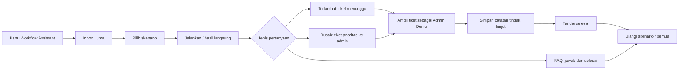
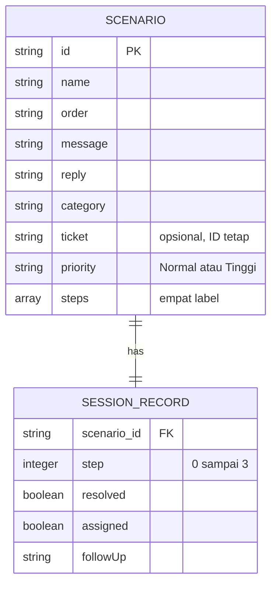

# Luma Support — BLUEPRINT

Versi 1.1 · 27 Oktober 2026 · Proyek konsep portfolio VELKIRA.

## Pelaksanaan dan finalisasi — 28 Oktober 2026

Blueprint sudah diwujudkan sebagai demo aplikasi, bukan hanya rencana. Pemeriksaan terbaru tidak menambah fitur di luar MVP; implementasi yang sudah ada dipertahankan dan dicocokkan dengan persyaratan.

| Tahap | Implementasi yang dapat diperiksa | Status |
| --- | --- | --- |
| PRD | Tiga skenario toko online umum; FAQ tanpa tiket; keluhan menjadi tiket | Selesai untuk scope demo |
| Arsitektur | Route Next.js, Client Component dan CSS Module; static export tanpa backend | Selesai |
| Model/kontrak | Reducer dengan guard, ID stabil, assignment, catatan, penyelesaian dan reset | Selesai |
| UI | Ringkasan, inbox, chat, workflow, tabel tiket, penanggung jawab dan riwayat | Selesai |
| Integrasi | Kartu Coba Demo di agency serta link kembali | Selesai |
| Pengujian | Build produksi dan 11/11 tes dijalankan ulang pada 28 Oktober 2026 | Lulus |
| Preview/paket | Route `/demos/luma-support/`; hasil hosting di `release/velkira-sundays-hosting.zip` | Disiapkan lokal |
| Rilis publik | Deployment dan HTTPS pada domain produksi | Belum diverifikasi |

Audit kode terbatas: catatan dirender sebagai string React, tidak memakai HTML mentah; tidak ada API bisnis, query SQL, secret atau pengiriman pesan dalam demo. Tes memeriksa klik berulang, tiket tanpa duplikasi, validasi catatan, callback timer usang, pergantian skenario, serta reset. Audit ini bukan sertifikasi keamanan, audit aksesibilitas penuh, atau uji dengan pelanggan nyata.

Cara mencoba: pilih Bima atau Citra → jalankan simulasi → Ambil Tiket → tulis dan simpan catatan contoh → Tandai Selesai → buka daftar tiket dan riwayat. Pilih Alya untuk melihat FAQ selesai tanpa tiket. Reload mengembalikan seluruh data ke awal.

## Revisi 1.1 — Pencatatan toko online umum

Permintaan lanjutan pemilik: tetap relevan untuk mayoritas toko online dan perjelas pencatatan layanan pelanggan. Bukan pencatatan stok, pembayaran, atau omzet.

Urutan pengerjaan revisi:

1. PRD: setiap tiket memiliki pelanggan, pesanan, kategori, ringkasan, prioritas, status, penanggung jawab dan catatan tindak lanjut. FAQ cukup dijawab tanpa tiket.
2. Arsitektur: pertahankan Next.js static export dan reducer lokal; tidak menambah database/integrasi untuk demo portfolio.
3. Model: tambah `assigned` boolean dan `followUp` string pada record sesi. Status setelah diteruskan: Menunggu/Perlu Admin → Ditangani → Selesai. Catatan minimal 5 dan maksimal 280 karakter setelah trim; wajib tersimpan sebelum menyelesaikan tiket.
4. UI: form catatan sederhana, error yang terhubung ke field, detail tiket lengkap, dan riwayat penanganan yang diturunkan dari state. Palet biru/navy tetap.
5. Implementasi: model + tes → form + detail + tabel → QA desktop/mobile → build dan paket hosting.

Acceptance criteria: tiket harus diambil oleh admin simulasi sebelum dicatat/ditutup; catatan kosong/terlalu panjang ditolak, klik berulang tidak menggandakan pencatatan, pergantian percakapan tidak membawa draft ke tiket lain, reset menghapus owner/catatan/hasil. Semua status dan catatan tetap ada saat berpindah layar dalam sesi, tetapi reload mengembalikan demo ke awal. Admin tidak benar-benar mengecek ekspedisi atau mengirim kabar; catatan adalah latihan penanganan.

Action tambahan: `assign` hanya untuk tiket pada tahap final dan belum selesai; `note` hanya setelah assigned dan sebelum selesai; `resolve` memerlukan assigned serta catatan valid. SQL/API/auth tidak diperlukan pada scope ini. Kasus kelak untuk sistem operasional harus dirancang terpisah sebelum integrasi pelanggan nyata.

Checklist revisi (status diperbarui setelah verifikasi):

- [x] R01 — Scope, kontrak data, status, dan batas demo ditetapkan.
- [x] R02 — Implementasi reducer dan tes assignment/validasi/reset.
- [x] R03 — Implementasi detail, catatan, riwayat dan tabel.
- [x] R04 — Build, tes dan QA browser; hasil dicatat di bawah.

Hasil revisi 1.1, 27 Oktober 2026: production build lulus dan 11/11 tes lulus. Browser desktop 1440 px dan mobile 390 px diperiksa; tidak ada overflow halaman (document width ≤ viewport). Alur Menunggu → Ambil Tiket → Ditangani → Simpan Catatan → Selesai dicoba. Catatan kosong menampilkan error dan tombol selesai tetap disabled; catatan valid masuk ke riwayat dan mengaktifkan penyelesaian. Bukti visual: `qa/ticket-handling-desktop.png` dan `qa/ticket-handling-mobile.png`. Penanganan dan catatan tidak dikirim ke pihak lain. Pengujian perangkat Safari/iOS nyata, usability dengan peserta dan deployment belum dilakukan.

Dokumen mengikuti Tahap 1–5 dari panduan Chain-of-Prompts pemilik. Alur dan palet telah ditentukan dalam percakapan. Scope: demo lokal dan integrasi portfolio; bukan layanan pelanggan operasional.

## Tahap 1 — PRD

### Executive summary dan KPI

Luma Support adalah dashboard customer service toko online fiktif Luma Store. Calon klien mencoba jawaban FAQ, pencatatan tiket, dan eskalasi ke admin. Respons pratulisan, bukan AI. Tujuan bisnisnya memperlihatkan kemampuan VELKIRA merancang aplikasi dan otomatisasi, melengkapi portfolio cafe SunDays.

| KPI | Target | Verifikasi |
| --- | --- | --- |
| Pemahaman | 4 dari 5 peserta dapat menjelaskan perbedaan FAQ dan eskalasi | Usability test, belum dilakukan |
| Kemudahan | 4 dari 5 peserta menjalankan satu skenario tanpa bantuan | Usability test, belum dilakukan |
| Kebenaran | Tiga alur menghasilkan status/jumlah tiket tepat | Unit test dan interaksi browser |
| Integrasi | Link portfolio → demo → portfolio bekerja | Export dan HTTP/browser |
| Responsif | Tanpa overflow halaman pada 360–1440 px | Browser; tabel boleh scroll lokal |
| Kejelasan | Label demo tersedia sebelum interaksi | Inspeksi HTML dan visual |

KPI merupakan target, bukan klaim hasil. Analytics tidak dipasang untuk demo.

### Persona dan core flow

- Pemilik bisnis/calon klien: ingin memahami manfaat otomatisasi tanpa istilah teknis; membutuhkan hasil konkret dan batas kemampuan yang jelas.
- Pengunjung portfolio di ponsel: waktu singkat; membutuhkan navigasi sederhana dan tombol kembali.



### MVP vs fase berikutnya

| Must-have MVP | Acceptance criteria |
| --- | --- |
| Ringkasan | Empat metrik berasal dari state simulasi, bukan statistik bisnis palsu |
| Inbox | Tiga pelanggan/pesanan fiktif, pilihan skenario, chat dan status |
| Simulasi | Satu langkah sekitar 1 detik; hasil langsung tersedia |
| Tiket | Dibuat pada tahap pencatatan; FAQ tidak menghasilkan tiket |
| Eskalasi | Barang rusak berprioritas tinggi dan masuk antrean admin simulasi |
| Penyelesaian | Admin mengambil tiket, menyimpan catatan valid, lalu menandai selesai |
| Reset | Per skenario dan global; timer lama dibatalkan |
| Mobile | Daftar dan detail bergantian; tombol kembali berfungsi |
| Integrasi | Preview dashboard, Coba Demo, dan tautan balik portfolio |
| Transparansi | Label simulasi, tanpa AI aktif/pengiriman/penyimpanan lintas reload |

Fase 2 hanya jika diminta: pencarian untuk banyak tiket, editor FAQ, database, autentikasi, integrasi channel, AI, dan audit log nyata. Tidak membuat tombol/menu fitur tersebut sebagai dekorasi.

### Sitemap dan komponen

Route `/demos/luma-support/`; Ringkasan, Inbox dan Tiket memakai state lokal. Sidebar berisi wordmark/workspace/nav/count/link portfolio. Header berisi breadcrumb, sandbox mode, judul dan reset. Ringkasan menampilkan penjelasan serta tiga pilihan skenario. Inbox terdiri dari daftar pelanggan, chat, kontrol simulasi, panel workflow dan ringkasan tiket. Tiket berisi empty state atau tabel tiket nyata dari state. Footer memuat kredit konsep serta tautan kembali.

### Edge cases

| Kasus | Respons |
| --- | --- |
| Klik mulai berulang | Satu proses aktif; tidak membuat tiket ganda |
| Pindah skenario/nav saat berjalan | Pause; progres tiap skenario tetap di sesi |
| Reset/restart dengan timer aktif | Token berubah; tick usang diabaikan |
| Hasil langsung saat running | Batalkan timer; hasil sama dengan alur bertahap |
| Resolve tanpa assignment/catatan atau sebelum alur selesai | Ditolak reducer; kontrol belum tersedia atau disabled |
| FAQ selesai | Tidak ada tiket atau tombol resolve |
| Tiket kosong | Empty state dan CTA skenario yang menghasilkan tiket |
| Reload | Semua kembali ke awal; batas ini dijelaskan |
| Reduced motion | Mulai langsung mencapai hasil, tanpa animasi bertahap |
| JS mati | HTML awal terbaca; noscript menjelaskan dan menyediakan link kembali |
| ID/view tidak dikenal | Reducer menolak perubahan |
| Layar sempit/teks panjang | Wrap, min-width:0, tabel scroll lokal |

Tidak ada fetch/backend sehingga tidak membuat error jaringan fiktif. Tidak ada checkout, pembayaran, atau pengiriman nyata. Form catatan hanya memperbarui state lokal.

### Non-functional requirements

- Tidak menambah dependency runtime, request pihak ketiga, atau media besar.
- Static export dengan metadata, satu H1 dan bahasa Indonesia; canonical menunggu URL produksi final.
- Target jika kelak diukur: LCP ≤2,5 detik, INP ≤200 ms, CLS ≤0,1; belum merupakan hasil pengukuran.
- Keyboard, focus-visible, label status, live region tahap aktif, reduced motion, dan kontrol utama sekitar 44 px di mobile.
- Periksa 360–1440 px; 320 px sebagai stress test.
- Tidak meminta PII atau API key; tidak ada secret atau request write. Catatan contoh 5–280 karakter hanya berada di memori sesi dan dirender sebagai teks. Tidak mengklaim audit WCAG/keamanan produksi penuh.

## Tahap 2 — Technical Blueprint

| Lapisan | Keputusan dan alasan |
| --- | --- |
| Frontend | Next.js App Router/React terpasang; tidak menambah framework |
| Rendering | Server page metadata; dashboard Client Component untuk state |
| Styling | CSS Module, terisolasi dari tema agency; Manrope yang sudah tersedia |
| State | useReducer, satu sumber kebenaran untuk record dan statistik |
| Timer | useEffect/setTimeout dengan cleanup; run token menolak callback usang |
| Backend/database | Tidak ada; simulasi browser lokal |
| Hosting | Mengikuti export `out/` agency; tidak membuat hosting baru |
| Caching | Aset statis Next/hosting; tanpa service worker/localStorage |
| Auth | Tidak ada karena tidak ada operasi server/data privat |
| Environment | Tidak membutuhkan env, API key, payment atau email |

```text
app/demos/luma-support/
  page.js                  route dan metadata
  Dashboard.js             komponen interaktif
  dashboard.module.css     token/layout/state/responsive
  workflow.mjs             skenario dan reducer murni
tests/luma.test.mjs         tes alur dan static export
public/assets/concepts/luma-support.svg
dokumen/luma-support/BLUEPRINT.md
```

Integrasi menyentuh `app/page.js`, README, pemeriksaan ZIP, dan tes ekspor untuk link route direktori. Migrasi Next.js yang sudah ada di working tree dipertahankan. Panduan lokal page/layout, Server/Client Components dan static export dibaca sebelum coding. Tidak memakai API server yang tidak didukung static export.

## Tahap 3 — Model data dan kontrak

### Model logis, bukan database aktif



Scenario adalah konten pratulisan; record hanya di memori. Tiket merupakan proyeksi scenario dengan ticket ID dan record.step ≥2, bukan array terpisah yang dapat terduplikasi. ID stabil shipping/late/damage; tiket LM-002 dan LM-003. Data fiktif seluruhnya.

State tambahan: view (`overview/inbox/tickets`), selected, mobileDetail, running dan run token. Step 0 pesan masuk, 1 identifikasi, 2 jawaban/pencatatan, 3 hasil akhir. Resolved hanya untuk tiket setelah step 3, sudah assigned, dan memiliki catatan tindak lanjut valid. Statistik diturunkan dari record.

| Action internal | Payload | Hasil/guard |
| --- | --- | --- |
| view | view | Hanya tiga view valid; hentikan timer |
| select | id | ID dikenal; buka detail dan pause proses lama |
| back | Tidak ada | Daftar mobile; hentikan proses |
| start | Tidak ada | Mulai/resume jika step <3 dan tidak running |
| tick | run | Naik satu tahap jika token sama dan running |
| finish | Tidak ada | Step 3; token baru; batalkan timer |
| assign | Tidak ada | Ambil tiket final yang belum diambil/selesai |
| note | value | Catatan 5–280 karakter, setelah assigned, sebelum selesai |
| resolve | Tidak ada | Selesai setelah assigned dan catatan valid |
| restart | Tidak ada | Reset record aktif dan tiket turunannya |
| reset | Tidak ada | Reset seluruh record dan view awal, token baru |

Tidak ada API GET/POST/PUT/DELETE bisnis, payload jaringan, kode error API, SQL, indeks atau migrasi pada MVP. Jika sistem operasional diminta, desain ulang conversation/messages/tickets/events/users, autentikasi/role, retensi, consent, retry/idempotency dan kontrak API sebelum backend dibangun. Database tidak ditambahkan hanya untuk memenuhi template.

## Tahap 4 — Design system dan UI blueprint

| Token | HEX | Peran |
| --- | --- | --- |
| Primary / hover | #345CFF / #2447D8 | Tombol, nav aktif, chat asisten |
| Sidebar | #14213D | Navigasi |
| Background / surface | #F4F6FA / #FFFFFF | Kanvas/panel |
| Text / muted | #172033 / #596579 | Judul/teks sekunder |
| Border | #E2E7F0 | Pemisah dekoratif |
| Success | #166534 / #DCFCE7 | Teks/latar selesai |
| Waiting | #92400E / #FEF3C7 | Teks/latar menunggu |
| Escalated | #B42318 / #FEE4E2 | Teks/latar prioritas |

Font Manrope dari root next/font; tidak mengunduh keluarga baru. H1 fluid 25–36 px, H2 panel 12–20 px, isi 11–13 px, metadata kecil 8–10 px. Mobile memperbesar isi chat/detail. Metadata kecil bukan satu-satunya petunjuk tindakan/status; keterbacaan perlu QA visual.

Spacing 4/8/12/16/20/24/32 px. Radius panel 14 px, kartu 12 px, tombol 8 px. Shadow `0 4px 20px #17203303`. Sidebar desktop 214 px; inbox terdiri daftar 232 px, chat fleksibel, workflow 264 px. Tablet: workflow di bawah. Mobile: inbox/detail bergantian.

| Reusable UI | State |
| --- | --- |
| Nav | Default/hover/focus/active; count dari record |
| Button | Default/hover/focus; disabled saat running/resolved |
| Avatar | Initials fiktif dengan warna pembeda |
| Badge | Baru/Diproses/Menunggu/Perlu Admin/Selesai; selalu berlabel |
| Conversation row | Selected/unselected; status mengikuti record |
| Chat | Awal/kategori/jawaban/hasil akhir |
| Workflow step | Menunggu/aktif/selesai |
| Ticket | Belum tercatat/terbuka/selesai |
| Ticket list | Empty state atau daftar dari simulasi |
| Process indicator | Loading lokal dengan teks; bukan klaim AI tersambung |

Tidak perlu skeleton jaringan untuk konten lokal. Form catatan lokal berfungsi dengan validasi; tidak membuat modal atau error API palsu. Ikon SVG sederhana dan preview dashboard dibuat langsung sebagai aset vektor asli proyek, tanpa logo/aset pihak lain.

## Tahap 5 — Project rules, plan, dan QA

### Rules

1. Pertahankan scope demo dan label simulasi; tidak memakai data asli.
2. Ikuti versi Next.js lokal; tidak menambah dependency/backend tanpa kebutuhan.
3. Status/tiket/metrik berasal dari reducer; jangan membuat salinan state.
4. Timer selalu cleanup dan token; reset/pindah tidak menerima tick usang.
5. Render string melalui React, bukan HTML mentah.
6. Responsif, keyboard/fokus, reduced motion dan empty state sejak awal.
7. Tidak mengirim pesan, menyimpan lintas sesi atau menjanjikan refund.
8. Uji reducer, export dan interaksi; laporkan batas pemeriksaan.
9. Agency dan cafe tetap berfungsi; perubahan integrasi hanya yang diperlukan.
10. Deployment dan audit produksi tidak dinyatakan selesai tanpa bukti.

### Checklist berurutan

- [x] L01 — Tetapkan PRD, skenario, scope dan palet dari percakapan.
- [x] L02 — Baca panduan Next lokal dan arsitektur export.
- [x] L03 — Buat reducer/model/aturan tiket/reset.
- [x] L04 — Buat sidebar, ringkasan, inbox, chat, workflow, tiket.
- [x] L05 — Tambahkan timer, hasil langsung, resolve dan reset.
- [x] L06 — CSS responsif, fokus, live status, reduced motion, noscript.
- [x] L07 — Preview SVG, kartu portfolio, tautan kembali.
- [x] L08 — Unit test dan pemeriksaan export/packaging.
- [x] L09 — Production build dan semua tes; perbaiki kegagalan.
- [x] L10 — QA browser desktop/mobile, timer, empty state dan reset; batas pengujian dicatat di bawah.
- [x] L11 — Bangun ulang dan verifikasi ZIP hosting.
- [ ] L12 — Publikasi hosting produksi jika diminta; verifikasi URL/HTTPS.

### Definition of done dan audit

Demo lokal selesai setelah tiga alur benar, timer/reset aman, tidak ada tiket ganda, navigasi berfungsi, export tersedia, portfolio terhubung dan hasil tes dilaporkan. Rilis publik merupakan langkah terpisah.

Audit minimum: tidak ada input sensitif/key/network write; string chat tidak menjadi HTML injection; klik ganda tidak menggandakan tiket; metadata dan satu H1 tersedia; label simulasi jelas; paket export tidak berisi source/arsip. QA pada 390/1440 px, keyboard, reduced motion, daftar tiket kosong, dan reset saat proses berjalan.

### Hasil baseline v1.0 (sebelum revisi pencatatan)

Implementasi dan pemeriksaan 27 Oktober 2026:

- `npm run build`: lulus; route `/demos/luma-support/` diekspor statis. Metadata OG memakai origin domain yang dipilih pemilik, `https://velkira.site`; ini bukan bukti domain telah dideploy.
- `npm test`: 10/10 lulus, termasuk alur FAQ tanpa tiket, tiket hanya setelah pencatatan, eskalasi, resolusi, klik mulai berulang, reset/restart, callback usang, export dan HTTP agency/cafe. Tes HTTP sempat ditolak izin socket sandbox; dijalankan ulang di host dan lulus.
- `package-site.ps1`: ZIP hosting dibangun ulang dan diverifikasi, 73 file, termasuk demo dan preview Luma. Source/internal docs tidak dimasukkan.
- Browser lokal: FAQ bertahap selesai tanpa tiket; barang rusak menjadi LM-003/Perlu Admin; resolve memperbarui metrik; tiket tetap dapat dibuka dari daftar; pesanan terlambat menjadi LM-002/Menunggu; reset menghapus hasil dan tiket.
- Viewport 1440, default sekitar 1176, 390 dan 360 px diperiksa. Ditemukan overflow mobile akibat label tabel tersembunyi yang absolut; diperbaiki dengan posisi eksplisit. Pemeriksaan ulang: lebar dokumen ≤ viewport, termasuk ketika tabel tiket berisi data.
- Tombol kembali mobile tersedia; perpindahan fokus dari heading detail ke tombol dengan keyboard diperiksa. Ini bukan audit keyboard/pembaca layar menyeluruh.
- Ringkasan dan CTA menuju Inbox, empty state tiket setelah reset, serta perjalanan portfolio → Coba Demo → kembali ke portfolio diperiksa di browser dan berfungsi.
- Console browser yang diperiksa: tidak ada error/warning tercatat.
- Bukti visual: `qa/desktop.png` dan `qa/mobile.png`.

Belum diuji: usability dengan peserta, audit WCAG/kontras penuh, preferensi reduced motion melalui emulasi browser (jalur implementasi tersedia), Safari/iOS nyata, Lighthouse/Core Web Vitals lapangan, dan produksi HTTPS/domain. Tidak ada deployment, commit atau push untuk perubahan ini.
